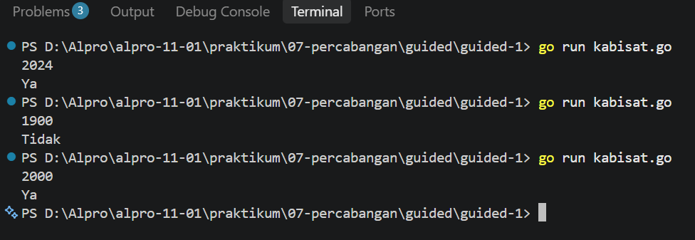
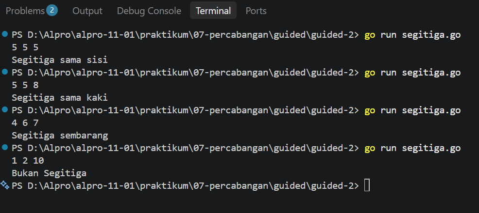
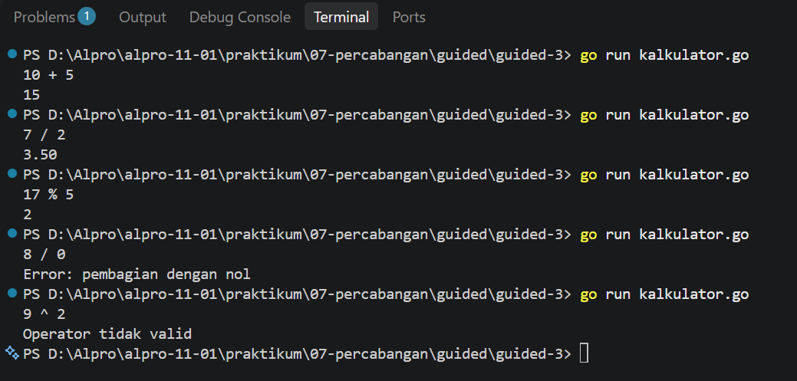
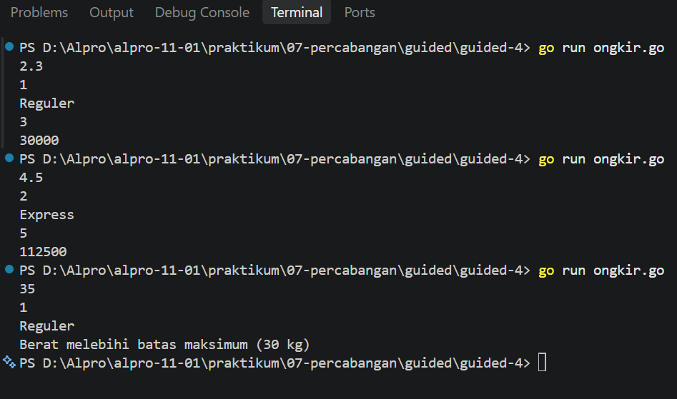
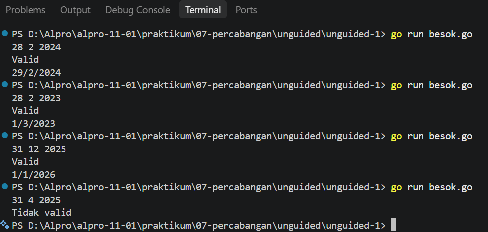
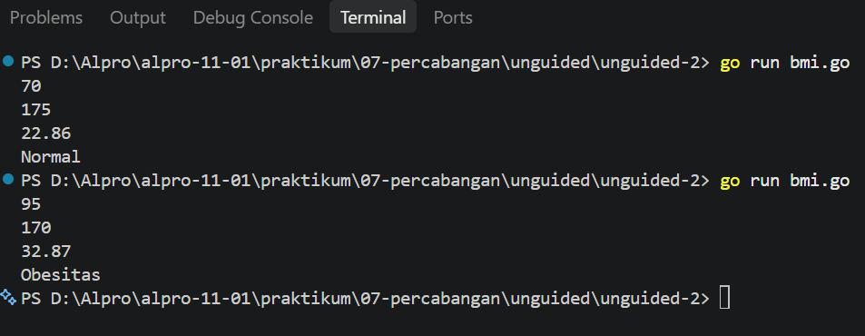

# <h1 align="center">Laporan Praktikum Modul 07 - Percabangan Bahasa Pemrograman Go (Golang)  
</h1>
<p align="center">Fadila Riska Amalia Juniar - 109092600007</p>

## Dasar Teori

### A. Pengertian Percabangan (Selection)
Percabangan atau selection adalah salah satu struktur dalam pemrograman yang digunakan untuk menentukan tindakan berdasarkan kondisi tertentu. Dengan percabangan, program dapat menjalankan perintah yang berbeda sesuai dengan hasil pemeriksaan kondisi. Percabangan membuat program dapat mengambil keputusan secara otomatis berdasarkan data yang dimasukkan oleh pengguna.

### B. Percabangan if, else if, dan else
Dalam bahasa Go, if, else if, dan else digunakan untuk memeriksa beberapa kondisi.
- if digunakan untuk memeriksa kondisi pertama. Jika kondisi bernilai benar, perintah di dalamnya akan dijalankan.
- else if digunakan untuk memeriksa kondisi lain jika kondisi sebelumnya tidak terpenuhi.
- else digunakan ketika semua kondisi sebelumnya tidak terpenuhi.
Percabangan ini biasanya digunakan ketika program memiliki beberapa kemungkinan hasil yang harus diperiksa secara berurutan.

#### C. Percabangan switch
Switch merupakan struktur percabangan yang digunakan untuk memilih satu tindakan dari beberapa pilihan yang tersedia. Program akan membandingkan nilai yang diperiksa dengan setiap case. Jika ada yang sesuai, perintah pada bagian tersebut akan dijalankan. Jika tidak ada yang sesuai, program dapat menjalankan bagian default.

Penggunaan switch membuat kode lebih rapi dan mudah dibaca, terutama ketika terdapat banyak pilihan seperti operasi matematika atau jenis layanan.

#### D. Operator Perbandingan dan Logika
Dalam percabangan, operator perbandingan dan operator logika digunakan untuk menentukan apakah suatu kondisi benar atau salah.

1. Operator Perbandingan
Operator Fungsi
- == Sama dengan
- != Tidak sama dengan
- >	Lebih besar dari
- <	Lebih kecil dari
- >= Lebih besar atau sama dengan
- <= Lebih kecil atau sama dengan

2. Operator Logika
Operator & Fungsinya
- `&&`, `AND` berfungsi kedua kondisi harus benar
- `||`, `OR` berfungsi salah satu kondisi harus benar
- `!`, `NOT` berfungsi membalikkan nilai kondisi

Operator tersebut digunakan untuk menggabungkan beberapa kondisi agar program dapat melakukan pemeriksaan yang lebih sesuai dengan kebutuhan.

#### E. Penggunaan Percabangan dalam Program
Percabangan dapat digunakan dalam berbagai program, seperti menentukan tahun kabisat, mengelompokkan jenis segitiga, membuat kalkulator sederhana, menghitung ongkos kirim, dan menentukan kategori indeks massa tubuh. Dengan menggabungkan percabangan dan operator, program dapat memeriksa data yang dimasukkan pengguna kemudian memberikan hasil sesuai dengan ketentuan yang sudah dibuat.

## Guided

### 1. [kabisat.go]

```go
package main

import "fmt"

func main() {
	var tahun int
	fmt.Scan(&tahun)

	if (tahun % 4 == 0 && tahun % 100 != 0) || (tahun % 400 == 0) {
		fmt.Println("Ya")
	} else {
		fmt.Println("Tidak")
	}
}	
```
#### Deskripsi
Pada program `kabisat.go`, saya membuat program untuk menentukan apakah suatu tahun termasuk tahun kabisat atau bukan. Program menerima input berupa tahun, kemudian memeriksa apakah tahun tersebut habis dibagi 400 atau habis dibagi 4 tetapi tidak habis dibagi 100. Jika memenuhi salah satu kondisi tersebut, program menampilkan `"Ya"`. Jika tidak, program menampilkan `"Tidak"`.

##### Output
<!-- Path relatif dari readme.md ke folder unguided/[nama_soal]/output.png, contoh: -->


### 2. [segitiga.go]

```go
package main

import "fmt"

func main() {
	var a, b, c int
	fmt.Scan(&a, &b, &c)

	if a <= 0 || b <= 0 || c <= 0 || a+b <= c || a+c <= b || b+c <= a {
		fmt.Println("Bukan Segitiga")
	} else if a == b && b == c{
		fmt.Println("Segitiga sama sisi")
	} else if a == b || a == c || b == c{
		fmt.Println("Segitiga sama kaki")
	} else {
		fmt.Println("Segitiga sembarang")
	}
}
```

##### Output
<!-- Path relatif dari readme.md ke folder unguided/[nama_soal]/output.png, contoh: -->


#### Deskripsi
Pada program `segitiga.go`, saya membuat program untuk menentukan jenis segitiga berdasarkan panjang ketiga sisinya. Program menerima input berupa tiga bilangan, kemudian memeriksa apakah ketiga sisi tersebut dapat membentuk segitiga. Jika valid, program membandingkan panjang sisinya untuk menentukan apakah termasuk segitiga sama sisi, sama kaki, atau sembarang

<!-- Tambahkan blok file/kode lain sesuai jumlah file pada soal guided -->

### 3. [kalkulator.go]

```go
package main

import "fmt"

func main() {
	var a, b int
	var op string

	fmt.Scan(&a, &op, &b)

	switch op {
		case "+":
			fmt.Println(a + b)
		case "-":
			fmt.Println(a - b)
		case "*":
			fmt.Println(a * b)
		case "/":
			if b == 0 {
				fmt.Println("Error: pembagian dengan nol")
			} else {
				fmt.Printf("%.2f\n", float64(a)/float64(b))
			}
		case "%":
			if b == 0 {
				fmt.Println("Error: pembagian dengan nol")
			} else {
				fmt.Println(a % b)
			}
		default:
			fmt.Println("Operator tidak valid")
	}
}
```

##### Output
<!-- Path relatif dari readme.md ke folder unguided/[nama_soal]/output.png, contoh: -->


#### Deskripsi
Pada program `kalkulator.go`, saya membuat program kalkulator sederhana yang menerima dua bilangan dan satu operator matematika. Program menggunakan switch untuk menentukan operasi yang akan dilakukan, seperti penjumlahan, pengurangan, perkalian, pembagian, dan sisa bagi. Program juga memeriksa pembagian dengan nol dan menampilkan pesan jika operator yang dimasukkan tidak valid.

### 4. [ongkir.go]

```go
package main

import (
	"fmt"
	"math"
)

func main() {
	var berat float64
	var zona int
	var layanan string

	fmt.Scan(&berat, &zona, &layanan)

	if berat > 30 {
		fmt.Println("Berat melebihi batas maksimum (30 kg)")
		return
	}

	var tarifPerKg int

	switch zona {
	case 1:
		tarifPerKg = 10000
	case 2:
		tarifPerKg = 15000
	case 3:
		tarifPerKg = 25000
	default:
		fmt.Println("Zona tidak valid")
		return
	}

	beratBulat := int(math.Ceil(berat))
	total := beratBulat * tarifPerKg

	if layanan == "Express" {
		total += total/2
	} else if layanan != "Reguler" {
		fmt.Println("Layanan tidak valid")
		return
	}

	fmt.Println(beratBulat)
	fmt.Println(total)
}
```

##### Output
<!-- Path relatif dari readme.md ke folder unguided/[nama_soal]/output.png, contoh: -->


#### Deskripsi
Pada program `ongkir.go`, saya membuat program untuk menghitung biaya pengiriman berdasarkan berat paket, zona tujuan, dan jenis layanan. Program menggunakan switch untuk menentukan tarif sesuai zona, kemudian membulatkan berat paket ke atas menggunakan `math.Ceil()`. Setelah itu, biaya dihitung berdasarkan berat dan tarif. Jika menggunakan layanan Express, biaya akan ditambah 50%, sedangkan layanan Reguler tidak mendapatkan biaya tambahan.

<!-- Tambahkan blok file/kode lain sesuai jumlah file pada soal guided -->

## Unguided

### 1. [besok.go]

```go
package main

import "fmt"

func main() {
	var tanggal, bulan, tahun int
	var jumlahHari int

	fmt.Scan(&tanggal, &bulan, &tahun)

	if tahun <= 0 || bulan < 1 || bulan > 12 {
		fmt.Println("Tidak valid")
		return
	}

	switch bulan {
	case 1, 3, 5, 7, 8, 10, 12:
		jumlahHari = 31
	case 4, 6, 9, 11:
		jumlahHari = 30
	case 2:
		if tahun%400 == 0 || (tahun%4 == 0 && tahun%100 != 0) {
			jumlahHari = 29
		} else {
			jumlahHari = 28
		}
	}

	if tanggal < 1 || tanggal > jumlahHari {
		fmt.Println("Tidak valid")
	} else {
		fmt.Println("Valid")

		tanggal++

		if tanggal > jumlahHari {
			tanggal = 1
			bulan++

			if bulan > 12 {
				bulan = 1
				tahun++
			}
		}

		fmt.Printf("%d/%d/%d\n", tanggal, bulan, tahun)
	}
}
```

##### Output
<!-- Path relatif dari readme.md ke folder unguided/[nama_soal]/output.png, contoh: -->


#### Deskripsi
Pada program `besok.go`, saya membuat program untuk memeriksa apakah tanggal, bulan, dan tahun yang dimasukkan valid serta menentukan tanggal keesokan harinya. Program menggunakan `switch` untuk menentukan jumlah hari setiap bulan dan memeriksa tahun kabisat khusus bulan Februari. Jika tanggal valid, program menambahkan satu hari. Program juga memeriksa pergantian bulan dan tahun jika tanggal sudah mencapai akhir bulan atau akhir tahun.

### 2. [bmi.go]

```go
package main

import "fmt"

func main() {
	var berat, tinggi, bmi float64
	var kategori string

	fmt.Scan(&berat, &tinggi)

	tinggi = tinggi / 100

	bmi = berat / (tinggi * tinggi)

	if bmi < 18.5 {
		kategori = "Kurus"
	} else if bmi < 25 {
		kategori = "Normal"
	} else if bmi < 30 {
		kategori = "Gemuk"
	} else {
		kategori = "Obesitas"
	}

	fmt.Printf("%.2f\n", bmi)
	fmt.Println(kategori)
}
```

##### Output
<!-- Path relatif dari readme.md ke folder unguided/[nama_soal]/output.png, contoh: -->


#### Deskripsi
Pada program `bmi.go`, saya membuat program untuk menghitung indeks massa tubuh (BMI) berdasarkan berat dan tinggi badan. Program menerima input berat badan dalam kilogram dan tinggi badan dalam sentimeter, kemudian mengubah tinggi menjadi meter. Setelah itu, BMI dihitung menggunakan rumus berat badan dibagi tinggi badan kuadrat. Hasil perhitungan kemudian diperiksa menggunakan percabangan `if, else if, dan else` untuk menentukan kategori Kurus, Normal, Gemuk, atau Obesitas.

## Kesimpulan
Setelah melakukan praktikum Modul 07, saya memahami penggunaan percabangan dalam bahasa Go, seperti `if`, `else if`, `else`, dan `switch`. Saya belajar menggunakan percabangan untuk memeriksa kondisi, membandingkan nilai, serta menentukan hasil berdasarkan input yang diberikan. Melalui praktikum ini, saya juga memahami bahwa percabangan dapat diterapkan dalam berbagai program, seperti menentukan tahun kabisat, menghitung ongkos kirim, membuat kalkulator, dan menentukan kategori BMI. Dengan begitu, saya menjadi lebih memahami cara kerja pengambilan keputusan dalam sebuah program.

## Referensi
1. Universitas Telkom. (t.t.). Soal Tugas Praktikum Modul 07: Algoritma dan Pemrograman — Percabangan Bahasa Pemrograman Go (Golang). Laboratorium Praktikum Informatika, Fakultas Informatika, Program Studi S1 Rekayasa Perangkat Lunak.
<!-- Tambahkan nomor referensi berikutnya sesuai kebutuhan -->