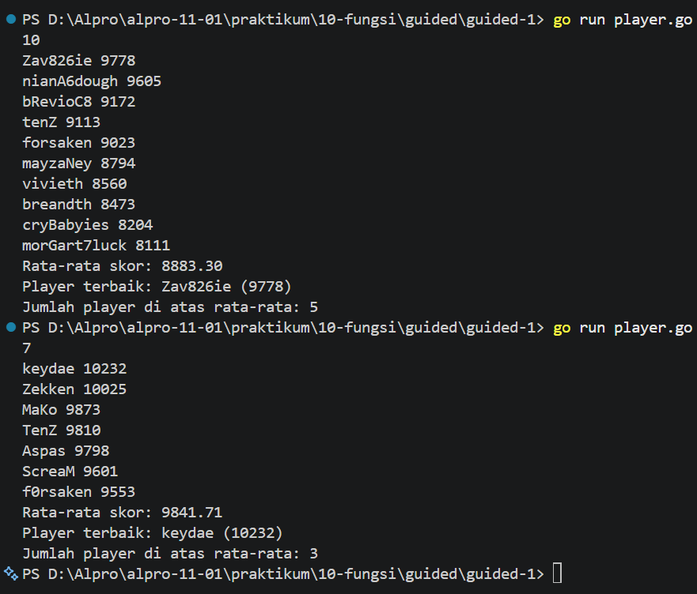
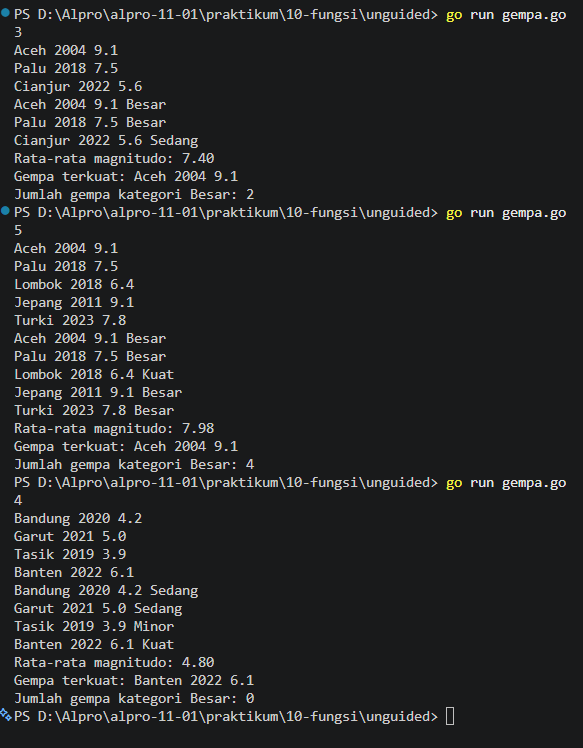

# <h1 align="center">Laporan Praktikum Modul 10 - Fungsi Bahasa Pemrograman Go (Golang)  
</h1>
<p align="center">Fadila Riska Amalia Juniar - 109092600007</p>

## Dasar Teori

### A. Pengertian Fungsi (Function)
Fungsi adalah satu kesatuan rangkaian instruksi yang menghasilkan suatu nilai, biasanya dengan memetakan input ke nilai lain. Karena itu, fungsi selalu mengembalikan nilai. Suatu subprogram disebut fungsi jika ada deklarasi tipe nilai yang dikembalikan dan ada kata kunci return di dalam badannya.

### B. Kegunaan dan Penamaan Fungsi
Fungsi dipakai di tempat yang membutuhkan nilai, misalnya untuk assignment ke variabel, sebagai bagian dari ekspresi, atau sebagai argumen subprogram lain. Karena menghasilkan nilai, nama fungsi sebaiknya berupa kata benda atau kata sifat, contohnya rataRata, nilaiTerbesar, dan kategori.

#### C. Deklarasi Fungsi
Fungsi ditulis di blok terpisah dari program utama (`func main()`). Bentuk penulisannya di Go:

```go
func <nama fungsi> (<parameter>) <tipe> {
	/* deklarasi variabel lokal */
	/* badan fungsi */
	return <nilai/variabel>
}
```
Tipe nilai yang dikembalikan ditulis setelah parameter, sedangkan nilai yang dikembalikan ditulis lewat return di dalam badan fungsi.

#### D. Pemanggilan Fungsi
Fungsi dipanggil dengan menuliskan nama fungsi beserta argumen yang diminta. Fungsi juga bisa dipanggil secara tidak langsung, yaitu lewat fungsi lain, seperti faktorial yang dipanggil oleh permutasi.

#### E. Parameter pada Fungsi
Parameter formal adalah parameter yang ditulis saat fungsi dideklarasikan, sedangkan parameter aktual adalah argumen yang dikirim saat fungsi dipanggil. Jumlah dan tipe parameter aktual harus sesuai dengan parameter formal. Parameter pada fungsi sebaiknya pass by value, yaitu nilainya disalin sehingga perubahan di dalam fungsi tidak memengaruhi variabel di pemanggil.

#### F. Array dan Struct
Pada praktikum ini data disimpan dalam array yang berisi struct. Struct menggabungkan beberapa data berbeda tipe dalam satu tipe, misalnya player yang berisi nickname dan score. Array berisi struct memudahkan pengolahan banyak data sejenis dengan perulangan.

#### G. Percabangan
Fungsi sering memakai percabangan if, else if, dan else untuk memilih hasil berdasarkan kondisi, seperti menentukan kategori gempa dari nilai magnitudonya.

## Guided

### 1. [player.go]

```go
package main

import "fmt"

const NMAX int = 999

type player struct {
	nickname string
	score    int
}

type tabPlayer [NMAX]player

// rataRata mengembalikan rata-rata skor dari n player
func rataRata(T tabPlayer, n int) float64 {
	var total int = 0
	var i int
	for i = 0; i < n; i++ {
		total = total + T[i].score
	}
	return float64(total) / float64(n)
}

// idxTertinggi mengembalikan indeks player dengan skor tertinggi
// (jika ada skor sama, diambil yang pertama muncul)
func idxTertinggi(T tabPlayer, n int) int {
	var idx int = 0
	var i int
	for i = 1; i < n; i++ {
		if T[i].score > T[idx].score {
			idx = i
		}
	}
	return idx
}

// hitungDiAtas mengembalikan banyaknya player dengan skor lebih dari batas
func hitungDiAtas(T tabPlayer, n int, batas float64) int {
	var jumlah int = 0
	var i int
	for i = 0; i < n; i++ {
		if float64(T[i].score) > batas {
			jumlah++
		}
	}
	return jumlah
}

func main() {
	var T tabPlayer
	var n, i int

	fmt.Scan(&n)
	for i = 0; i < n; i++ {
		fmt.Scan(&T[i].nickname, &T[i].score)
	}

	var rata float64 = rataRata(T, n)
	var idx int = idxTertinggi(T, n)

	fmt.Printf("Rata-rata skor: %.2f\n", rata)
	fmt.Printf("Player terbaik: %s (%d)\n", T[idx].nickname, T[idx].score)
	fmt.Printf("Jumlah player di atas rata-rata: %d\n", hitungDiAtas(T, n, rata))
}	
```
#### Deskripsi
Pada program `player.go`, saya membuat program untuk `mengolah skor sejumlah player`. Program ini memakai tiga fungsi: `rataRata` untuk menghitung rata-rata skor, `idxTertinggi` untuk mencari indeks player dengan skor tertinggi, dan `hitungDiAtas` untuk menghitung jumlah player yang skornya di atas rata-rata. Di `rataRata`, `total skor` diubah ke `float64` dulu supaya hasil baginya tidak dibulatkan. Di `idxTertinggi`, indeks hanya diganti jika skornya lebih besar (>), jadi kalau ada skor yang sama, yang pertama muncul yang dipilih. Pada `main`, hasil fungsi langsung dipakai untuk mencetak `rata-rata skor`, `player terbaik`, dan `jumlah player di atas rata-rata`.

##### Output
<!-- Path relatif dari readme.md ke folder unguided/[nama_soal]/output.png, contoh: -->


<!-- Tambahkan blok file/kode lain sesuai jumlah file pada soal guided -->

## Unguided

### 1. [gempa.go]

```go
package main

import "fmt"

const NMAX int = 999

type gempa struct {
	nama      string
	tahun     int
	magnitudo float64
}

type tabGempa [NMAX]gempa

// kategori mengembalikan kategori gempa berdasarkan magnitudo m
func kategori(m float64) string {
	if m < 4.0 {
		return "Minor"
	} else if m < 6.0 {
		return "Sedang"
	} else if m < 7.0 {
		return "Kuat"
	}
	return "Besar"
}

// rataMagnitudo mengembalikan rata-rata magnitudo dari n gempa
func rataMagnitudo(T tabGempa, n int) float64 {
	var total float64 = 0
	var i int
	for i = 0; i < n; i++ {
		total = total + T[i].magnitudo
	}
	return total / float64(n)
}

// idxTerkuat mengembalikan indeks gempa dengan magnitudo terbesar
// (jika sama, diambil yang pertama muncul)
func idxTerkuat(T tabGempa, n int) int {
	var idx int = 0
	var i int
	for i = 1; i < n; i++ {
		if T[i].magnitudo > T[idx].magnitudo {
			idx = i
		}
	}
	return idx
}

// hitungKategori mengembalikan banyaknya gempa berkategori k
// (memanggil fungsi kategori di dalamnya)
func hitungKategori(T tabGempa, n int, k string) int {
	var jumlah int = 0
	var i int
	for i = 0; i < n; i++ {
		if kategori(T[i].magnitudo) == k {
			jumlah++
		}
	}
	return jumlah
}

func main() {
	var T tabGempa
	var n, i int

	fmt.Scan(&n)
	for i = 0; i < n; i++ {
		fmt.Scan(&T[i].nama, &T[i].tahun, &T[i].magnitudo)
	}

	for i = 0; i < n; i++ {
		fmt.Printf("%s %d %.1f %s\n", T[i].nama, T[i].tahun, T[i].magnitudo, kategori(T[i].magnitudo))
	}

	fmt.Printf("Rata-rata magnitudo: %.2f\n", rataMagnitudo(T, n))

	var idx int = idxTerkuat(T, n)
	fmt.Printf("Gempa terkuat: %s %d %.1f\n", T[idx].nama, T[idx].tahun, T[idx].magnitudo)
	fmt.Printf("Jumlah gempa kategori Besar: %d\n", hitungKategori(T, n, "Besar"))
}
```

##### Output
<!-- Path relatif dari readme.md ke folder unguided/[nama_soal]/output.png, contoh: -->


#### Deskripsi
Pada program `gempa.go`, saya membuat program untuk `mengelompokkan gempa berdasarkan magnitudonya`. Fungsi kategori memakai `if` dan `else if` untuk menentukan kategori: di bawah `4.0 Minor`, di bawah `6.0 Sedang`, di bawah `7.0 Kuat`, dan selain itu `Besar`. Fungsi `rataMagnitudo` menghitung rata-rata magnitudo, `idxTerkuat` mencari gempa dengan magnitudo terbesar, dan `hitungKategori` menghitung jumlah gempa pada kategori tertentu dengan memanggil fungsi kategori di dalamnya (pemanggilan tidak langsung). Pada `main`, program `mencetak setiap gempa beserta kategorinya`, `rata-rata magnitudo`, `gempa terkuat`, dan `jumlah gempa kategori Besar`.

## Kesimpulan
Setelah melakukan praktikum Modul 10, saya memahami bahwa fungsi di Go adalah subprogram yang mengembalikan nilai lewat return dan punya tipe data hasil yang ditulis setelah parameter. Saya belajar membuat fungsi yang dipanggil dari program utama maupun dari fungsi lain, memakai hasilnya langsung dalam ekspresi atau fmt.Printf, serta mengolah data dalam array berisi struct. Dengan memecah program menjadi fungsi-fungsi kecil seperti rataRata, idxTertinggi, dan kategori, kode menjadi lebih rapi, mudah dibaca, dan bisa dipakai ulang.

## Referensi
1. Universitas Telkom. (t.t.). Soal Tugas Praktikum Modul 10: Algoritma dan Pemrograman 2 — Fungsi Bahasa Pemrograman Go (Golang). Laboratorium Praktikum Informatika, Fakultas Informatika, Universitas Telkom.
2. Universitas Telkom. (t.t.). Modul Algoritma Pemrograman, Bab 5: Pemrograman Modular (Modul Fungsi dan Prosedur). Fakultas Informatika, Universitas Telkom.
<!-- Tambahkan nomor referensi berikutnya sesuai kebutuhan -->