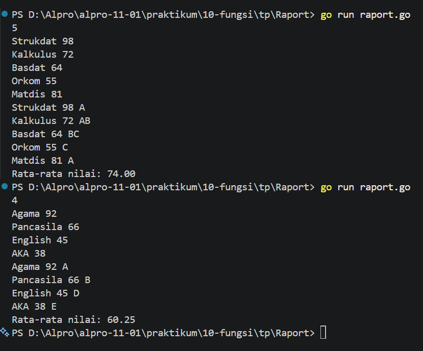
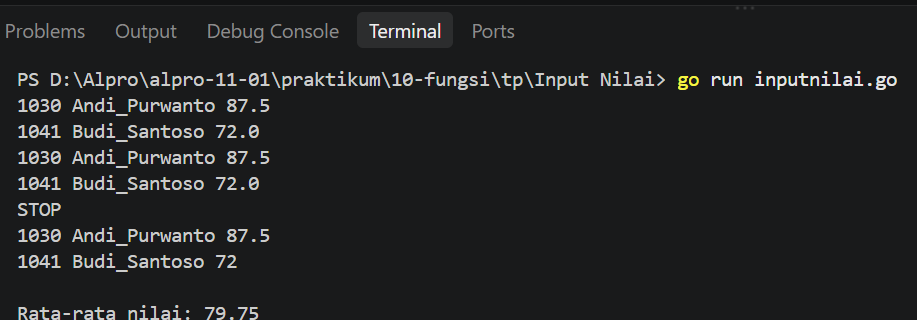
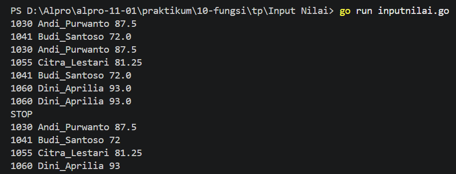
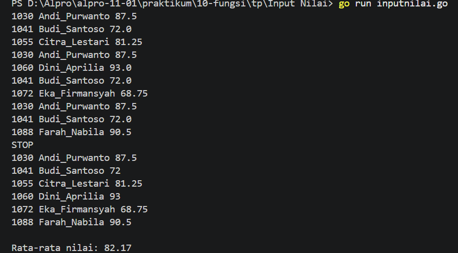

# <h1 align="center">Tugas Pendahuluan Modul 10 - "Fungsi" Bahasa Pemrograman Go (Golang)</h1>
<p align="center">Fadila Riska Amalia Juniar - 109092600007</p>

 ### 1. raport.go

```go
package main

import "fmt"

const NMAX int = 999

type rapot struct {
	matkul string
	nilai  int
}

type tabRapot [NMAX]rapot

// nilaiHuruf mengubah nilai angka menjadi nilai huruf
func nilaiHuruf(x int) string {
	var huruf string
	if x > 80 {
		huruf = "A"
	} else if x > 70 {
		huruf = "AB"
	} else if x > 65 {
		huruf = "B"
	} else if x > 60 {
		huruf = "BC"
	} else if x > 50 {
		huruf = "C"
	} else if x > 40 {
		huruf = "D"
	} else {
		huruf = "E"
	}
	return huruf
}

// rataRata menghitung rata-rata nilai dari n data pertama
func rataRata(T tabRapot, n int) float64 {
	var i, total int
	var hasil float64
	for i = 0; i < n; i++ {
		total = total + T[i].nilai
	}
	if n > 0 {
		hasil = float64(total) / float64(n)
	}
	return hasil
}

func main() {
	var T tabRapot
	var n, i int

	fmt.Scan(&n)
	for i = 0; i < n; i++ {
		fmt.Scan(&T[i].matkul, &T[i].nilai)
	}

	for i = 0; i < n; i++ {
		fmt.Println(T[i].matkul, T[i].nilai, nilaiHuruf(T[i].nilai))
	}
	fmt.Printf("Rata-rata nilai: %.2f\n", rataRata(T, n))
}
```

##### Output
<!-- Path relatif dari readme.md ke folder unguided/[nama_soal]/output.png, contoh: -->



#### Deskripsi
Program `raport.go` ini dipakai untuk menampilkan nilai huruf dari setiap mata kuliah, lalu menghitung rata-rata nilainya. Langkah pertama, program akan membaca jumlah mata kuliah, lalu membaca nama dan nilai angka tiap mata kuliah. Setiap nilai angka diubah menjadi nilai huruf (A, AB, B, BC, C, D, atau E) oleh fungsi `nilaiHuruf`. Rata-ratanya dihitung oleh fungsi `rataRata`. Di akhir, program menampilkan semua mata kuliah beserta nilainya, lalu rata-ratanya dengan dua angka di belakang koma.

Program ini bagian dari `Tugas Pendahuluan`. Dari program ini saya belajar membuat fungsi yang mengembalikan nilai dengan `return`, memakai `if, else if, dan else` di dalam fungsi, dan memanggil fungsi dari `main`.

### 2. inputnilai.go

```go
package main

import "fmt"

const NMAX int = 100

type student struct {
	nim, name string
	grade     float64
}

type students [NMAX]student

// cariNIM mengembalikan indeks data dengan NIM tersebut, atau -1 jika tidak ada
func cariNIM(T students, n int, nim string) int {
	var i int
	for i = 0; i < n; i++ {
		if T[i].nim == nim {
			return i
		}
	}
	return -1
}

// rataRata mengembalikan rata-rata nilai dari n data pertama pada T
func rataRata(T students, n int) float64 {
	var i int
	var total float64
	if n == 0 {
		return 0
	}
	for i = 0; i < n; i++ {
		total = total + T[i].grade
	}
	return total / float64(n)
}

func main() {
	var T students
	var n, i int
	var nim, name string
	var grade float64

	fmt.Scan(&nim)
	for nim != "STOP" && n < NMAX {
		fmt.Scan(&name, &grade)
		// hanya simpan data jika NIM belum pernah tersimpan
		if cariNIM(T, n, nim) == -1 {
			T[n].nim = nim
			T[n].name = name
			T[n].grade = grade
			n++
		}
		fmt.Scan(&nim)
	}

	for i = 0; i < n; i++ {
		fmt.Println(T[i].nim, T[i].name, T[i].grade)
	}
	fmt.Println()
	fmt.Printf("Rata-rata nilai: %.2f\n", rataRata(T, n))
}
```

##### Output
<!-- Path relatif dari readme.md ke folder unguided/[nama_soal]/output.png, contoh: -->




#### Deskripsi
Program `inputnilai.go` dipakai untuk membersihkan data mahasiswa yang dobel/kembar, lalu menghitung rata-rata nilainya. Program akan membaca NIM, nama, dan nilai satu per satu sampai NIM yang dimasukkan adalah `STOP`. Setiap kali ada data baru, program mengecek dulu dengan fungsi `cariNIM` apakah NIM itu sudah pernah disimpan. Kalau belum, datanya bakal disimpan. Kalau sudah, datanya dilewati. Setelah selesai, program menampilkan data yang sudah bersih sesuai urutan input, lalu rata-rata nilainya dengan dua angka di belakang koma.

Program ini bagian dari `Tugas Pendahuluan`. Dari program ini saya belajar membuat fungsi untuk mencari data di dalam array, memakai hasil fungsi sebagai syarat `if`, dan membuat perulangan yang berhenti saat user mengetik `STOP`.

#### Kesimpulan
Dari kedua program ini, saya belajar bahwa fungsi membantu memecah program menjadi bagian-bagian kecil yang punya tugas masing-masing, sehingga kode lebih rapi dan mudah dipahami. Fungsi bisa mengembalikan nilai dengan `return`, lalu hasilnya bisa langsung dipakai di `main`, baik untuk ditampilkan maupun untuk dihitung lebih lanjut.

Pada `raport.go`, saya memakai fungsi `nilaiHuruf` untuk mengubah nilai angka jadi nilai huruf dan fungsi `rataRata` untuk menghitung rata-rata. Pada `inputnilai.go`, saya memakai fungsi `cariNIM` untuk mengecek data yang sudah ada supaya tidak tersimpan dua kali. Saya juga jadi lebih paham cara menyimpan banyak data dengan array dan tipe bentukan (`struct`).