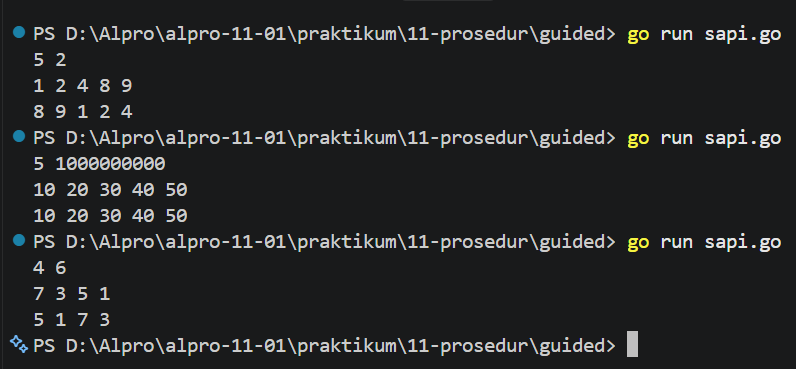
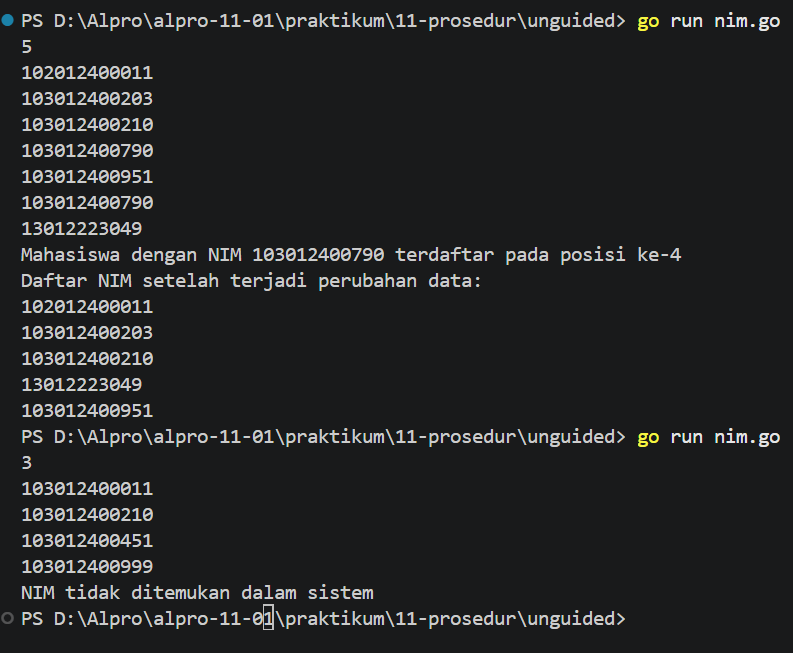

# <h1 align="center">Laporan Praktikum Modul 11 - Prosedure Bahasa Pemrograman Go (Golang)  
</h1>
<p align="center">Fadila Riska Amalia Juniar - 109092600007</p>

## Dasar Teori

### A. Pengertian Prosedur (Procedure)
Prosedur adalah potongan beberapa instruksi program yang dijadikan satu instruksi baru, tujuannya supaya kode program yang rumit menjadi lebih sederhana. Prosedur tidak menghasilkan nilai balik, tetapi memberikan akibat atau efek langsung pada program ketika dipanggil. Di Go, prosedur ditulis dengan kata kunci func, dengan ciri tidak ada deklarasi tipe nilai yang dikembalikan dan tidak ada kata kunci return di dalam badannya. Nama prosedur sebaiknya berbentuk kata kerja, seperti cetak, bacaData, atau cariNIM.

### B. Deklarasi dan Pemanggilan Prosedur
Prosedur ditulis di luar blok func main() dan boleh diletakkan sebelum maupun sesudah main. Bentuk penulisannya di Go:

```go
func <nama prosedur> (<parameter>) {
	/* deklarasi variabel lokal */
	/* badan prosedur */
}
```

Prosedur hanya dijalankan ketika dipanggil, baik langsung dari program utama maupun tidak langsung lewat subprogram lain. Cara memanggilnya cukup dengan menuliskan nama prosedur beserta argumen yang diminta, misalnya `cetakNFibo(x)`.

#### C. Perbedaan Fungsi dan Prosedur
Fungsi selalu mengembalikan nilai, sehingga bisa dipakai di tempat yang membutuhkan nilai, seperti pada assignment atau ekspresi. Prosedur tidak mengembalikan nilai, sehingga kedudukannya seperti instruksi biasa, mirip fmt.Scan atau fmt.Println.

#### D. Parameter Formal dan Parameter Aktual
Parameter formal adalah parameter yang ditulis saat prosedur dideklarasikan, fungsinya sebagai petunjuk argumen apa saja yang dibutuhkan. Parameter aktual adalah argumen yang dikirim saat prosedur dipanggil. Jumlah dan tipe data parameter aktual harus mengikuti parameter formal.

#### E. Pass by Value
Pada pass by value, nilai parameter aktual disalin ke parameter formal yang berada di alamat memori berbeda. Prosedur boleh memakai nilai tersebut untuk proses apa saja, tetapi perubahan di dalam prosedur tidak sampai ke pemanggil. Di pseudocode parameter ini diberi kata kunci in, sedangkan di Go tidak ada kata kunci khusus.

#### F. Pass by Reference (Pointer)
Pada pass by reference, parameter formal berperan sebagai pointer yang menyimpan alamat memori parameter aktual, sehingga perubahan nilai di dalam prosedur tetap terlihat oleh pemanggil setelah prosedur selesai. Di pseudocode memakai kata kunci in/out, sedangkan di Go ditulis dengan tanda bintang (*) sebelum tipe data pada parameter formal. Saat memanggil, parameter aktualnya harus diberi tanda ampersand (&), contohnya f2(a, b, &c). Untuk mengakses isinya di dalam prosedur, variabel pointer diberi tanda bintang, contohnya *hasil = ....

```go
func tukar(a, b *int) {
	*a, *b = *b, *a
}
// pemanggilan: tukar(&x, &y)
```

#### G. Initial State dan Final State

Setiap prosedur dapat dijelaskan dengan dua kondisi, yaitu Initial State (I.S.) yang menyatakan keadaan data sebelum prosedur dijalankan, dan Final State (F.S.) yang menyatakan keadaan data setelah prosedur selesai. Keduanya ditulis sebagai komentar di bawah deklarasi prosedur.

## Guided

### 1. [sapi.go]

```go
package main

import "fmt"

const NMAX = 10000

type Arr [NMAX]int

func mengisiSapi(T *Arr, n int) {
	for i := 0; i < n; i++ {
		fmt.Scan(&T[i])
	}
}

func geserKanan(T *Arr, n int) {
	var temp int = T[n-1]

	for i := n - 1; i > 0; i-- {
		T[i] = T[i-1]
	}

	T[0] = temp
}

func cetak(T Arr, n int) {
	for i := 0; i < n; i++ {
		fmt.Print(T[i], " ")
	}
	fmt.Println()
}

func main() {
	var n, k int
	fmt.Scan(&n, &k)

	var T Arr
	mengisiSapi(&T, n)

	k = k % n

	for i := 0; i < k; i++ {
		geserKanan(&T, n)
	}

	cetak(T, n)
}	
```
#### Deskripsi
Pada program `sapi.go`, saya membuat program untuk menentukan susunan sapi setelah `K` hari, di mana setiap hari sapi di kandang terakhir pindah ke kandang pertama dan sapi lainnya bergeser satu kandang ke kanan. Program ini memakai tiga prosedur: `bacaData` untuk membaca nomor sapi, `geserKanan` untuk menggeser susunan satu kali, dan `cetak` untuk menampilkan hasilnya.

`Array` dikirim sebagai pointer pada `bacaData` dan `geserKanan` karena isinya berubah, sedangkan `cetak` cukup `pass by value`. Karena K bisa sampai 10⁹, saya tidak memanggil geserKanan sebanyak K kali. Setelah N kali geser susunan kembali seperti semula, jadi cukup digeser sebanyak k % n kali.

##### Output
<!-- Path relatif dari readme.md ke folder unguided/[nama_soal]/output.png, contoh: -->


<!-- Tambahkan blok file/kode lain sesuai jumlah file pada soal guided -->

## Unguided

### 1. [nim.go]

```go
package main

import "fmt"

const NMAX int = 2002

type tabNIM [NMAX]int

// cariNIM mencari NIM x pada T[0..n-1]
// IS: T[0..n-1] dan x terdefinisi
// FS: idx berisi indeks NIM x pada T, atau -1 jika tidak ditemukan
func cariNIM(T tabNIM, n, x int, idx *int) {
	var i int
	*idx = -1
	for i = 0; i < n && *idx == -1; i++ {
		if T[i] == x {
			*idx = i
		}
	}
}

// ubahNIM mengganti isi T[idx] dengan NIM baru
// IS: T terdefinisi dan idx adalah indeks yang valid
// FS: T[idx] berisi NIM baru
func ubahNIM(T *tabNIM, idx, baru int) {
	T[idx] = baru
}

// cetak menampilkan setiap NIM pada T, satu per baris
// IS: T[0..n-1] terdefinisi
// FS: setiap NIM pada T tercetak satu per baris
func cetak(T tabNIM, n int) {
	var i int
	for i = 0; i < n; i++ {
		fmt.Println(T[i])
	}
}

func main() {
	var T tabNIM
	var n, i, x, baru, idx int

	fmt.Scan(&n)
	for i = 0; i < n; i++ {
		fmt.Scan(&T[i])
	}
	fmt.Scan(&x)

	cariNIM(T, n, x, &idx)

	if idx != -1 {
		fmt.Scan(&baru)
		fmt.Printf("Mahasiswa dengan NIM %d terdaftar pada posisi ke-%d\n", x, idx+1)
		ubahNIM(&T, idx, baru)
		fmt.Println("Daftar NIM setelah terjadi perubahan data:")
		cetak(T, n)
	} else {
		fmt.Println("NIM tidak ditemukan dalam sistem")
	}
}
```

##### Output
<!-- Path relatif dari readme.md ke folder unguided/[nama_soal]/output.png, contoh: -->


#### Deskripsi
Pada program `nim.go`, saya membuat program untuk `mencari NIM mahasiswa` dan menggantinya dengan `NIM baru` jika ditemukan. Prosedur `cariNIM` mencari NIM dari awal array dan mengirim hasilnya lewat parameter pointer `idx` (bernilai -1 jika tidak ada). Prosedur `ubahNIM` mengganti isi T[idx] dengan `NIM baru`, dan `cetak` menampilkan `semua NIM` satu per baris. Posisi yang ditampilkan adalah idx+1 karena posisi dimulai dari 1, sedangkan indeks array dari 0. NIM pengganti baru dibaca kalau NIM yang dicari ditemukan, sesuai ketentuan soal.

## Kesimpulan
Setelah melakukan praktikum Modul 11, saya memahami bahwa `prosedur` di Go adalah `func` yang tidak mengembalikan nilai dan berguna untuk memecah program menjadi bagian-bagian kecil yang lebih mudah dibaca. Saya juga memahami perbedaan `parameter formal` dan `parameter aktual`, serta perbedaan `pass by value` dan `pass by reference`.

`Pass by value` cocok untuk data yang hanya dibaca, sedangkan `pass by reference` memakai pointer `(* pada deklarasi dan & saat pemanggilan)` supaya hasil perubahan di dalam prosedur bisa dibawa kembali ke program utama, seperti pada prosedur `bacaData`, `geserKanan`, `cariNIM`, dan `ubahNIM`. Dari soal sapi, saya juga belajar bahwa memikirkan pola masalahnya, seperti memakai `k % n`, bisa membuat program jauh lebih efisien dibanding mengikuti prosesnya langkah demi langkah.

## Referensi
1. Universitas Telkom. (t.t.). Soal Tugas Praktikum Modul 11: Algoritma dan Pemrograman 2 — Prosedur Bahasa Pemrograman Go (Golang). Laboratorium Praktikum Informatika, Fakultas Informatika, Universitas Telkom.
2. Universitas Telkom. (t.t.). Modul Algoritma Pemrograman, Bab 5: Pemrograman Modular (Modul Fungsi dan Prosedur). Fakultas Informatika, Universitas Telkom.
<!-- Tambahkan nomor referensi berikutnya sesuai kebutuhan -->