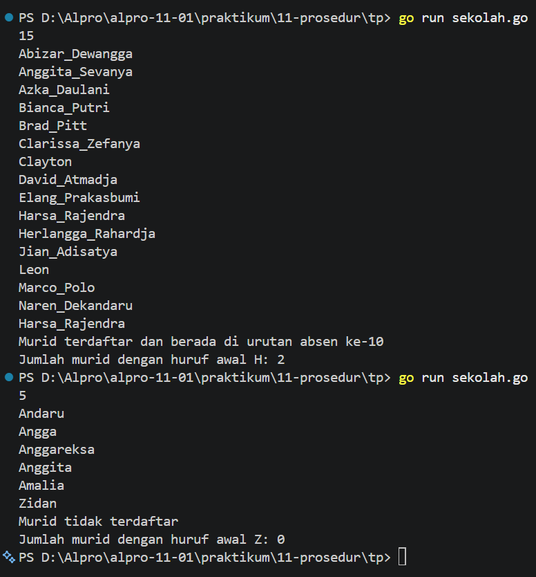
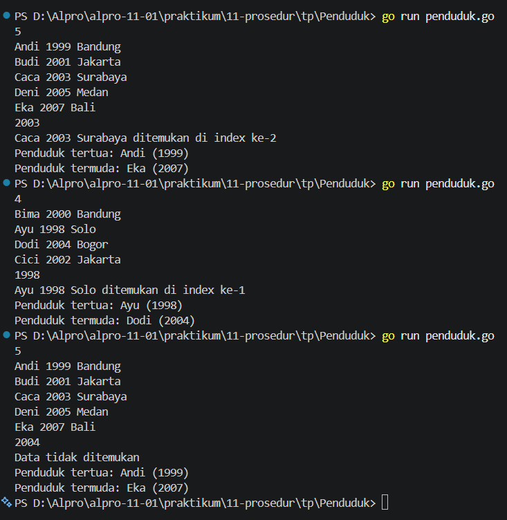

# <h1 align="center">Tugas Pendahuluan Modul 11 - "Prosedur" Bahasa Pemrograman Go (Golang)</h1>
<p align="center">Fadila Riska Amalia Juniar - 109092600007</p>

 ### 1. sekolah.go

```go
package main

import "fmt"

const NMAX int = 1001

type tabMurid [NMAX]string

// cariMurid mencari nama pada T[0..n-1].
// F.S. ketemu = true dan posisi berisi urutan absen (mulai dari 1) jika nama ditemukan,
// jika tidak ketemu = false.
func cariMurid(T tabMurid, n int, nama string, posisi *int, ketemu *bool) {
	var i int
	*posisi = 0
	*ketemu = false
	for i = 0; i < n && !*ketemu; i++ {
		if T[i] == nama {
			*ketemu = true
			*posisi = i + 1
		}
	}
}

// hitungHuruf menghitung banyaknya nama pada T[0..n-1] yang diawali huruf h.
func hitungHuruf(T tabMurid, n int, h byte, jumlah *int) {
	var i int
	*jumlah = 0
	for i = 0; i < n; i++ {
		if len(T[i]) > 0 && T[i][0] == h {
			*jumlah = *jumlah + 1
		}
	}
}

func main() {
	var T tabMurid
	var n, i, posisi, jumlah int
	var nama string
	var ketemu bool

	fmt.Scan(&n)
	for i = 0; i < n; i++ {
		fmt.Scan(&T[i])
	}
	fmt.Scan(&nama)

	cariMurid(T, n, nama, &posisi, &ketemu)
	if ketemu {
		fmt.Println("Murid terdaftar dan berada di urutan absen ke-" + fmt.Sprint(posisi))
	} else {
		fmt.Println("Murid tidak terdaftar")
	}

	hitungHuruf(T, n, nama[0], &jumlah)
	fmt.Printf("Jumlah murid dengan huruf awal %c: %d\n", nama[0], jumlah)
}
```

##### Output
<!-- Path relatif dari readme.md ke folder unguided/[nama_soal]/output.png, contoh: -->



#### Deskripsi
Program `sekolah.go` dipakai untuk mengecek apakah seorang murid terdaftar di sekolah, sekaligus menghitung berapa murid yang namanya diawali huruf yang sama dengan nama yang dicari. Program membaca jumlah murid, daftar namanya, lalu nama yang ingin dicari. Prosedur `cariMurid` mencari nama itu di daftar dan mengirim balik urutan absennya (mulai dari 1) serta status ketemu atau tidak. Prosedur `hitungHuruf` menghitung banyaknya nama yang huruf pertamanya sama dengan huruf pertama nama yang dicari. Di akhir, program menampilkan apakah murid terdaftar beserta urutan absennya, lalu jumlah murid dengan huruf awal tersebut.

Program ini bagian dari `Tugas Pendahuluan`. Dari program ini saya belajar membuat prosedur di Go, yaitu `func` tanpa `return`, dan cara prosedur mengirim hasil ke `main` lewat parameter pointer (`*`) yang dipanggil dengan `&`.

### 2. penduduk.go

```go
package main

import "fmt"

const NMAX int = 1000

type penduduk struct {
	nama  string
	tahun int
	kota  string
}

type tabPenduduk [NMAX]penduduk

// cariTahun mencari indeks data pertama dengan tahun lahir th, atau -1 jika tidak ada.
func cariTahun(T tabPenduduk, n, th int, idx *int) {
	var i int
	*idx = -1
	for i = 0; i < n && *idx == -1; i++ {
		if T[i].tahun == th {
			*idx = i
		}
	}
}

// tertuaTermuda mencari penduduk dengan tahun lahir terkecil (tua)
// dan tahun lahir terbesar (muda). Syarat: n >= 1.
func tertuaTermuda(T tabPenduduk, n int, tua, muda *penduduk) {
	var i int
	*tua = T[0]
	*muda = T[0]
	for i = 1; i < n; i++ {
		if T[i].tahun < (*tua).tahun {
			*tua = T[i]
		}
		if T[i].tahun > (*muda).tahun {
			*muda = T[i]
		}
	}
}

func main() {
	var T tabPenduduk
	var n, i, th, idx int
	var tua, muda penduduk

	fmt.Scan(&n)
	for i = 0; i < n; i++ {
		fmt.Scan(&T[i].nama, &T[i].tahun, &T[i].kota)
	}
	fmt.Scan(&th)

	cariTahun(T, n, th, &idx)
	if idx != -1 {
		fmt.Println(T[idx].nama, T[idx].tahun, T[idx].kota, "ditemukan di index ke-"+fmt.Sprint(idx))
	} else {
		fmt.Println("Data tidak ditemukan")
	}

	tertuaTermuda(T, n, &tua, &muda)
	fmt.Printf("Penduduk tertua: %s (%d)\n", tua.nama, tua.tahun)
	fmt.Printf("Penduduk termuda: %s (%d)\n", muda.nama, muda.tahun)
}
```

##### Output
<!-- Path relatif dari readme.md ke folder unguided/[nama_soal]/output.png, contoh: -->


#### Deskripsi
Program `penduduk.go` dipakai untuk menyimpan data penduduk (nama, tahun lahir, dan kota), mencari penduduk berdasarkan tahun lahir, lalu menampilkan penduduk tertua dan termuda. Program membaca jumlah data, isi datanya, lalu tahun lahir yang dicari. Prosedur `cariTahun` mencari data pertama dengan tahun lahir itu dan mengirim balik indeksnya, atau -1 kalau tidak ada. Prosedur `tertuaTermuda` mencari penduduk dengan tahun lahir terkecil (tertua) dan terbesar (termuda). Di akhir, program menampilkan hasil pencarian beserta indeksnya atau pesan "Data tidak ditemukan", lalu penduduk tertua dan termuda.

Program ini bagian dari `Tugas Pendahuluan`. Dari program ini saya belajar memakai prosedur dengan parameter pointer untuk mengembalikan lebih dari satu hasil sekaligus, serta mengolah data bertipe bentukan (`struct`) di dalam array.

#### Kesimpulan
Dari kedua program ini, saya belajar bahwa prosedur adalah subprogram yang tidak mengembalikan nilai dengan `return`. Kalau prosedur perlu mengirim hasil ke `main`, hasilnya dikirim lewat parameter pointer (`*`) dan dipanggil dengan `&`. Cara ini juga memungkinkan satu prosedur memberi lebih dari satu hasil, seperti `cariMurid` yang memberi posisi dan status ketemu, atau `tertuaTermuda` yang memberi data tertua dan termuda sekaligus. Dengan prosedur, program jadi lebih rapi karena tugasnya dibagi per bagian.

Pada `raport.go`, saya memakai fungsi `nilaiHuruf` untuk mengubah nilai angka jadi nilai huruf dan fungsi `rataRata` untuk menghitung rata-rata. Pada `inputnilai.go`, saya memakai fungsi `cariNIM` untuk mengecek data yang sudah ada supaya tidak tersimpan dua kali. Saya juga jadi lebih paham cara menyimpan banyak data dengan array dan tipe bentukan (`struct`).