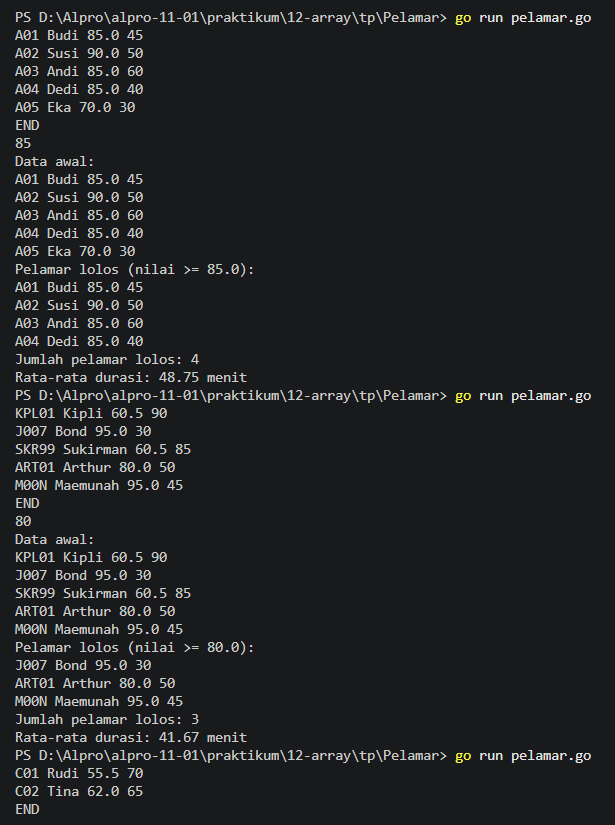
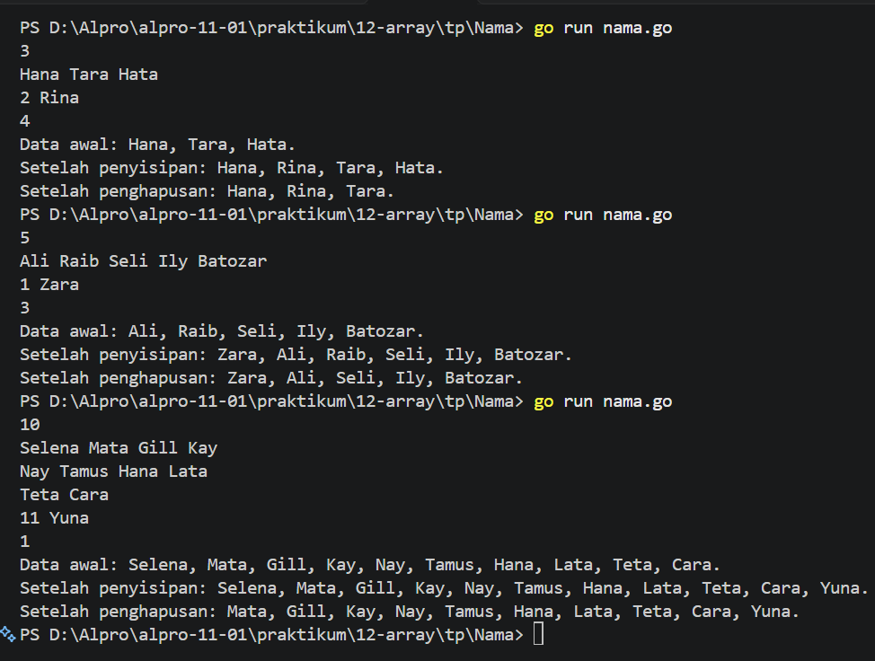

# <h1 align="center">Tugas Pendahuluan Modul 12 - "Array" Bahasa Pemrograman Go (Golang)</h1>
<p align="center">Fadila Riska Amalia Juniar - 109092600007</p>

 ### 1. pelamar.go

```go
package main

import "fmt"

const NMAX int = 100

type applicant struct {
	id, name     string
	testGrade    float64
	testDuration int
}

type applicants [NMAX]applicant

// IS : A[0..n-1] dan batas terdefinisi
// FS : B[0..m-1] berisi pelamar dari A dengan testGrade >= batas,
//      sesuai urutan kemunculan pada A
func salinLolos(A applicants, n int, batas float64, B *applicants, m *int) {
	var i int
	*m = 0
	for i = 0; i < n; i++ {
		if A[i].testGrade >= batas {
			B[*m] = A[i] // salin seluruh struct ke array kedua
			*m = *m + 1
		}
	}
}

func rataDurasi(B applicants, m int) float64 {
	var i, total int
	if m == 0 {
		return 0
	}
	for i = 0; i < m; i++ {
		total = total + B[i].testDuration
	}
	return float64(total) / float64(m)
}

func main() {
	var A, B applicants
	var n, m, i int
	var batas float64
	var id string

	// Baca data pelamar sampai "END"
	n = 0
	fmt.Scan(&id)
	for id != "END" && n < len(A) {
		A[n].id = id
		fmt.Scan(&A[n].name, &A[n].testGrade, &A[n].testDuration)
		n++
		fmt.Scan(&id)
	}
	fmt.Scan(&batas)

	salinLolos(A, n, batas, &B, &m)

	fmt.Println("Data awal:")
	for i = 0; i < n; i++ {
		fmt.Printf("%s %s %.1f %d\n", A[i].id, A[i].name, A[i].testGrade, A[i].testDuration)
	}

	fmt.Printf("Pelamar lolos (nilai >= %.1f):\n", batas)
	if m == 0 {
		fmt.Println("Tidak ada pelamar yang lolos")
	} else {
		for i = 0; i < m; i++ {
			fmt.Printf("%s %s %.1f %d\n", B[i].id, B[i].name, B[i].testGrade, B[i].testDuration)
		}
		fmt.Printf("Jumlah pelamar lolos: %d\n", m)
		fmt.Printf("Rata-rata durasi: %.2f menit\n", rataDurasi(B, m))
	}
}
```

##### Output
<!-- Path relatif dari readme.md ke folder unguided/[nama_soal]/output.png, contoh: -->


#### Deskripsi
Program `pelamar.go` dipakai untuk menyaring pelamar kerja yang nilai tesnya mencapai batas kelulusan. Program membaca data pelamar sampai menemukan kata "END", lalu membaca batas kelulusan. Prosedur `salinLolos` memindahkan pelamar yang lolos ke array kedua, dan fungsi `rataDurasi` menghitung rata-rata waktu pengerjaan mereka. Di akhir, program menampilkan data awal, daftar yang lolos, jumlahnya, dan rata-rata durasinya.

Program ini bagian dari `Tugas Pendahuluan`. Dari program ini saya belajar memakai `struct` untuk menyimpan beberapa data sekaligus dalam array, dan bahwa pembagian dua bilangan bulat perlu diubah ke `float64` supaya hasilnya tidak terpotong.

### 2. nama.go

```go
package main

import "fmt"

const NMAX int = 9999

type arrString [NMAX]string

// IS : n terdefinisi
// FS : A[0..n-1] terisi dari masukan
func bacaData(A *arrString, n int) {
	var i int
	for i = 0; i < n; i++ {
		fmt.Scan(&A[i])
	}
}

// FS : seluruh elemen tampil dipisahkan koma dan diakhiri titik
func cetakData(A arrString, n int) {
	var i int
	for i = 0; i < n; i++ {
		fmt.Print(A[i])
		if i < n-1 {
			fmt.Print(", ")
		} else {
			fmt.Print(".")
		}
	}
	fmt.Println()
}

// IS : A[0..n-1] terdefinisi, 1 <= p <= n+1
// FS : x berada pada posisi ke-p, elemen setelahnya bergeser ke kanan,
//      n bertambah 1
func sisipData(A *arrString, n *int, p int, x string) {
	var i int
	// geser elemen dari belakang agar tidak saling menimpa
	for i = *n; i > p-1; i-- {
		A[i] = A[i-1]
	}
	A[p-1] = x
	*n = *n + 1
}

// IS : A[0..n-1] terdefinisi, 1 <= q <= n
// FS : elemen pada posisi ke-q terhapus, elemen setelahnya bergeser
//      ke kiri, n berkurang 1
func hapusData(A *arrString, n *int, q int) {
	var i int
	for i = q - 1; i < *n-1; i++ {
		A[i] = A[i+1]
	}
	*n = *n - 1
}

func main() {
	var A arrString
	var n, p, q int
	var x string

	fmt.Scan(&n)
	bacaData(&A, n)
	fmt.Scan(&p, &x)
	fmt.Scan(&q)

	fmt.Print("Data awal: ")
	cetakData(A, n)

	sisipData(&A, &n, p, x)
	fmt.Print("Setelah penyisipan: ")
	cetakData(A, n)

	hapusData(&A, &n, q)
	fmt.Print("Setelah penghapusan: ")
	cetakData(A, n)
}
```

##### Output
<!-- Path relatif dari readme.md ke folder unguided/[nama_soal]/output.png, contoh: -->


#### Deskripsi
Program `nama.go` dipakai untuk menyisipkan satu nama ke daftar, lalu menghapus satu nama dari daftar itu. Prosedur `sisipData` menaruh nama baru di posisi yang diminta dan menggeser nama setelahnya ke kanan. Prosedur `hapusData` menghapus nama di posisi tertentu dan menggeser nama setelahnya ke kiri. Di akhir, program menampilkan daftar sebelum perubahan, setelah penyisipan, dan setelah penghapusan.

Program ini bagian dari `Tugas Pendahuluan`. Dari program ini saya belajar menggeser elemen array, yaitu ke kanan dimulai dari belakang dan ke kiri dimulai dari depan, supaya data tidak saling menimpa.

#### Kesimpulan
Dari praktikum ini, saya belajar bahwa tipe bentukan `struct` memudahkan penyimpanan beberapa data yang berkaitan dalam satu wadah, misalnya ID, nama, nilai, dan durasi pelamar. Array statis cocok untuk menyimpan banyak data sejenis dengan indeks yang dimulai dari 0. Saya juga belajar cara menyisipkan dan menghapus data array dengan menggeser elemen, dan urutan pergeserannya harus tepat supaya data tidak saling menimpa. Selain itu, prosedur memakai pointer untuk mengirim hasil ke `main`, sedangkan Go butuh konversi eksplisit seperti `float64` saat menghitung rata-rata supaya hasilnya tidak terpotong.